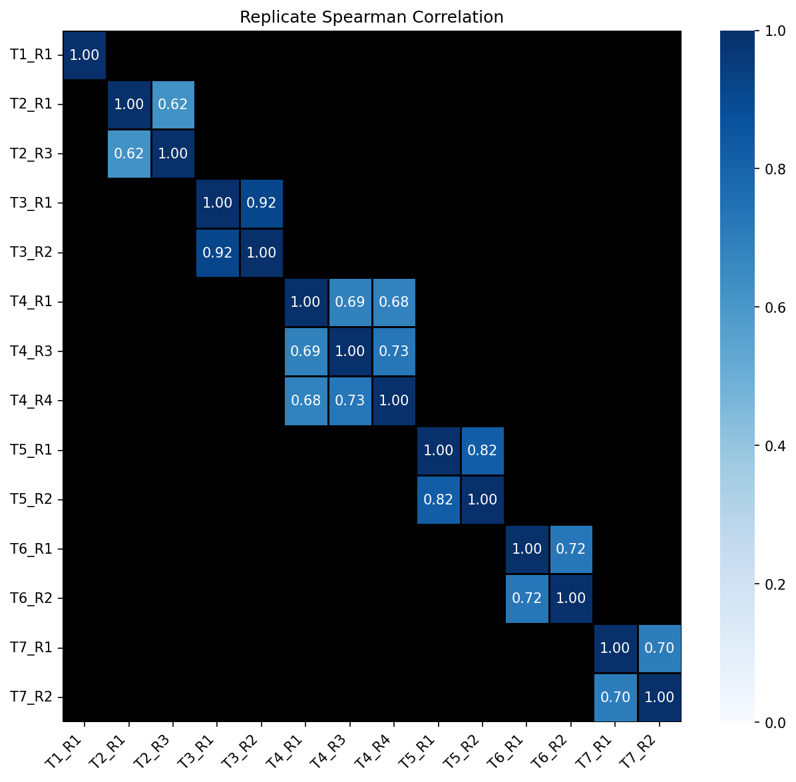
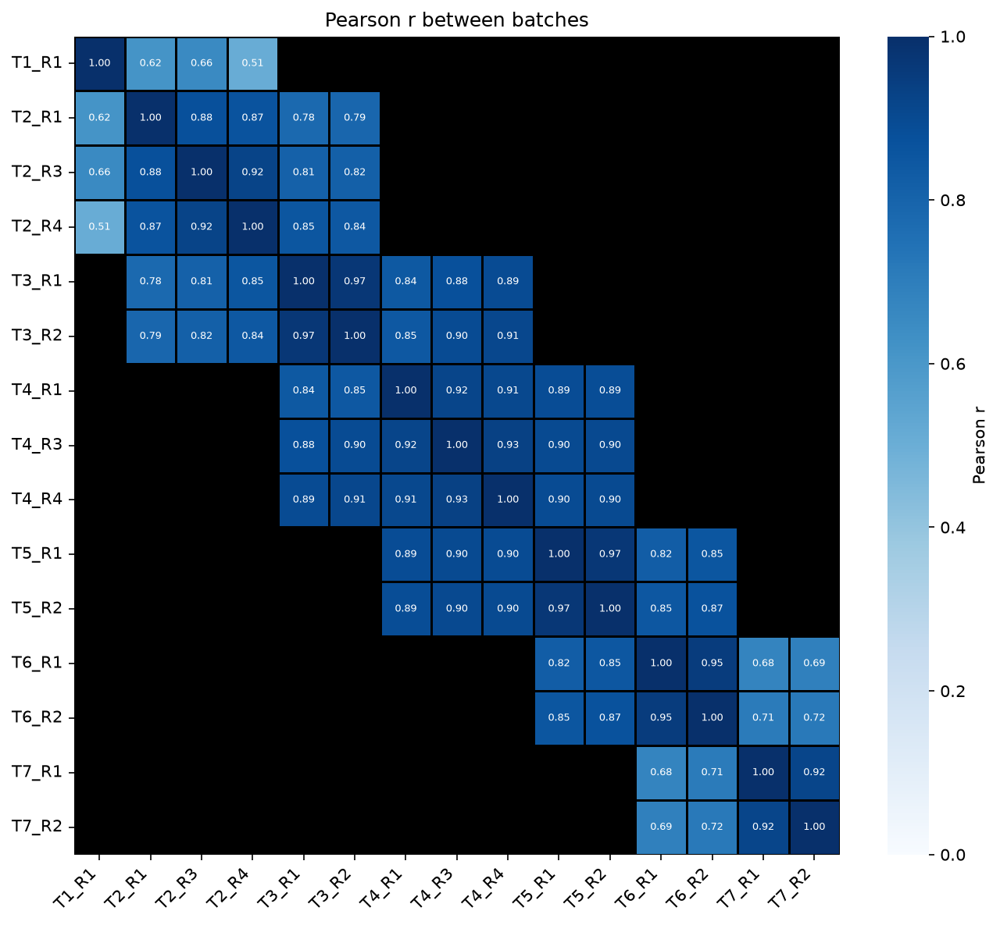
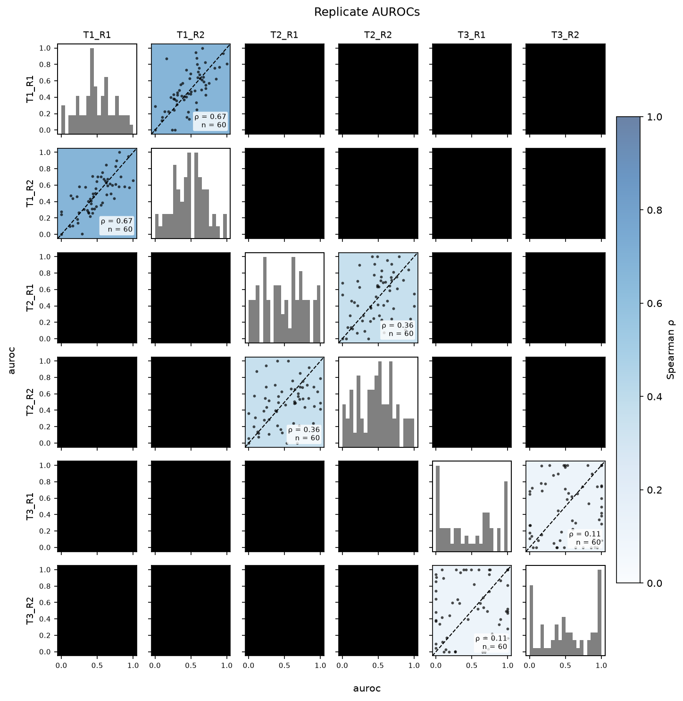
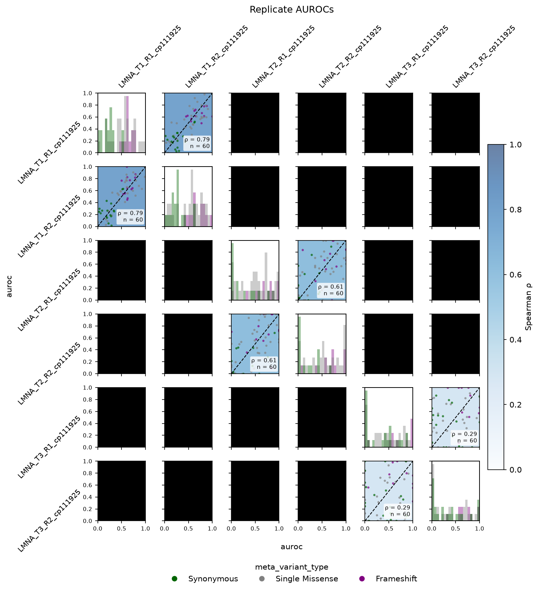
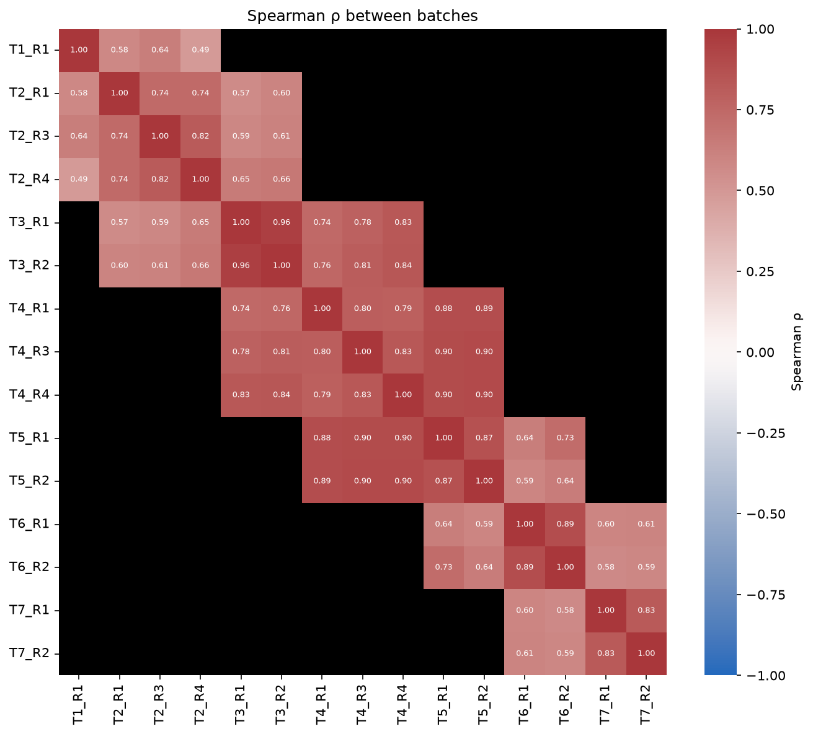
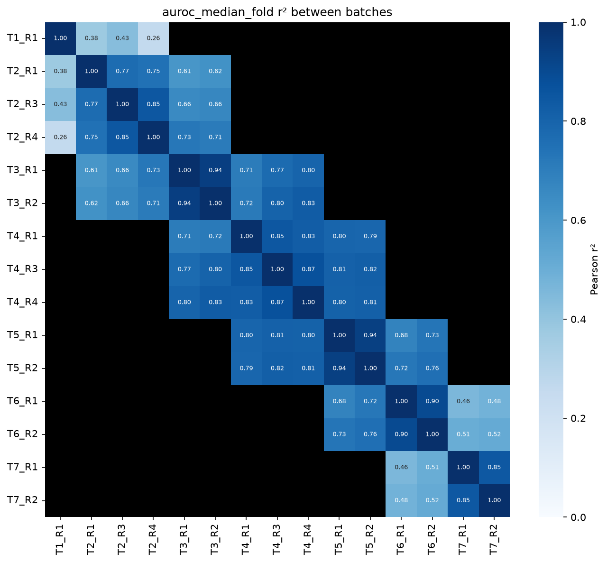

# Heatmaps

`Heatmap` draws a matrix given in either of two forms:

- **Long form:** one row per cell, with `index`, `columns` and `values` columns. It is pivoted for you.
- **Wide form:** an `index` column plus the matrix columns (`columns=[…]`, or every numeric column).

Rows and columns are sorted naturally unless you pass `row_order` / `col_order`. Any extra keyword
arguments, such as `linewidths` or `linecolor`, go straight to `seaborn.heatmap`.

## Pairwise matrix stored once per pair

Pairwise results are usually stored once per pair. `symmetric=True` fills each missing `(j, i)` cell
from `(i, j)`. `nan_color` sets the color shown for pairs that were never compared:

```python
import fisseqborn as fb

# one row per replicate pair within a tile (each replicate with itself too):
# rep_a, rep_b, spearman_r
(fb.Heatmap(rep_corr, index="rep_a", columns="rep_b", values="spearman_r",
            symmetric=True, nan_color="black",
            cmap="Blues", vmin=0, vmax=1, annot=True, fmt=".2f",
            linewidths=0.5, linecolor="black",
            figsize=(10, 9), title="Replicate Spearman Correlation")
   .save("vis/replicate_spearman_correlation_heatmap.png"))
```

{ width="520" }

*From `notebooks/2026-07-29/ovwt_rep_correlation`.*

## Batch correlation matrices

`BatchCorrelationHeatmap` computes that replicate matrix from the raw scores. You pass long-form
data with a `batch` column, a `label` column and a `score` column. Each cell is the correlation
(Spearman by default) of `score` between two batches, using one point per label the two batches
share. Pairs of batches that share no labels, or fewer than `min_shared` (default 10), are drawn
black:

```python
# one row per (experiment, variant): experiment, variant, test_auroc
(fb.BatchCorrelationHeatmap(ovwt, batch="experiment", label="variant", score="test_auroc",
                            title="Replicate Spearman Correlation")
   .save("vis/replicate_spearman_correlation_heatmap.png"))
```

{ width="520" }

*`method="pearson"` on the 2026-09-29 OvWT scores (`batch="meta_experiment",
label="meta_aa_changes", score="auroc_median_fold"`). Batches on different tiles share no
variants, so only the block diagonal is filled.*

`method=` can be `"spearman"`, `"pearson"` or `"cosine"`, and `squared=True` shows the
squared correlation (for example ρ²). `.pairs()` returns the numbers behind the plot:
`batch_a, batch_b, r, r_squared, n_shared`. Duplicate
`(batch, label)` rows are an error unless you pass `aggregate="mean"` (or similar).

### Two different scores

`y_score=` puts a second score on the rows (the y axis), while `score` stays on the columns (the x axis).
Cell `(a, b)` is the correlation of batch a's `y_score` with batch b's `score` over the labels the
two batches share. The two scores must be columns of the same frame, so join them on
`(batch, label)` first if they come from different tables:

```python
# one row per (experiment, variant): auroc_median_fold, missense_score
(fb.BatchCorrelationHeatmap(scores, batch="meta_experiment", label="meta_aa_changes",
                            score="auroc_median_fold", y_score="missense_score")
   .save("vis/ovwt_vs_missense_correlation_heatmap.png"))
```

The matrix is no longer symmetric. Its diagonal isn't 1: it holds each batch's own correlation
between the two scores. The axes are labeled with the two column names by default. Use
`.set(xlabel=..., ylabel=...)` to rename them. `.pairs()` then has one row per *ordered* pair, with
`batch_a` the row batch and `batch_b` the column batch.

### Scatter grid

`BatchCorrelationGrid` takes the same arguments and draws the same layout, but each cell is the
scatter plot behind its correlation: panel `(a, b)` has batch b's `score` on x and batch a's
`score` (or `y_score`) on y, one point per shared label. Without `y_score` the diagonal shows a
histogram of each batch's scores. Columns share x limits and rows share y limits, so each batch has
one scale throughout. Every panel has x tick labels; y tick labels are on the left column.

```python
(fb.BatchCorrelationGrid(ovwt, batch="experiment", label="variant", score="test_auroc",
                         identity=True, title="Replicate AUROCs")
   .save("vis/replicate_auroc_scatter_grid.png"))
```

{ width="620" }

*Synthetic data: three tiles with two replicates each, noisier on later tiles.*

By default each panel's background is tinted by its correlation on the heatmap's `Blues` 0–1 scale,
with a shared colorbar (`cmap=`, `vmin=`, `vmax=`, and `tint_alpha=` to keep points visible on dark
panels), and the correlation and shared-label count are written in the corner. Turn either off with
`tint=False` / `annot=False`. Pairs with fewer than `min_shared` shared labels are drawn in
`nan_color` with no points. `identity=True` adds the dashed `y = x` line to the scatter panels, and
`lims=(0, 1)` fixes both axes of every panel (and the histograms' range), for example for AUROCs.
`label_rotation=` slants the batch names for long experiment names: `45` slants both the column
and row names, and `90` makes the column names vertical and the row names horizontal. `height=` sets
each panel's size in inches (1.6 by default); the figure size follows from it. `scatter_kws` / `hist_kws` go to `ax.scatter` / `ax.hist`. It is figure-level:
`plot()` returns `(fig, axes)`, with `axes` a 2-D array. `.pairs()` returns the same numbers as the
heatmap's.

`hue=` colors the points by a column that describes the label, such as the variant type, and splits
each diagonal histogram into one overlaid histogram per level. Known levels get the fisseq order
and palette; `hue_order=` / `palette=` override them, and the legend goes below the grid. The first
level in `hue_order` is drawn on top, so put the one you most need to see (e.g. synonymous
controls) first. The hue
must have one value per label across batches, because each point is a label shared by two batches.
The correlations still use every shared label, whatever its hue.

`marginals="hist"` or `marginals="kde"` adds the distribution of each scatter panel's shared points
in strips along its top (x scores) and right (y scores) edges, split by `hue` when it is given.
Histograms use the same bins as the batch's diagonal histogram, and `hist_kws` applies to them.
Each KDE level is scaled by its share of the points. `marginal_size=` sets the strip depth as a
fraction of the panel (0.25 by default); the figure grows to fit the strips.

```python
fb.BatchCorrelationGrid(ovwt, batch="experiment", label="variant", score="test_auroc",
                        hue="meta_variant_type", identity=True, lims=(0, 1),
                        label_rotation=45)
```

{ width="620" }

`fill_value=` fills whatever is still missing, for example `fill_value=0.5` for barcode-pair AUROC
matrices. Duplicate `(index, columns)` pairs are an error unless you pass `aggregate="mean"` (or
`"median"`, `"first"`, …).

## Correlation matrices

`Heatmap.correlation` computes the matrix for you: Pearson, Spearman, or cosine similarity between
columns. It defaults to a diverging `vlag` scale from -1 to 1 with annotations:

```python
pcs = [f"meta_pc_{i}" for i in range(1, 6)]
fb.Heatmap.correlation(df, pcs, method="cosine").save("vis/pc_similarity.png")
```

Each cell is computed over the rows where both of its columns are finite, so sparse inputs work.
For example, you can pass one column per batch where each batch covers a single tile. Spearman
ranks within each pair's shared rows. Cells with fewer than `min_shared` shared rows (default 10)
are NaN, so pass `nan_color="black"` to show them. The shared-row counts are on the plot's
`n_shared` attribute. `y_columns=` puts different columns on the rows than on the x axis
(`fb.Heatmap.correlation(df, cols, y_columns=other)`), which gives a `len(other) × len(cols)` matrix.
Pass `squared=True` to show r² (or ρ²) on a 0–1 `Blues` scale instead:

```python
by_batch = scores.df.pivot(on="meta_experiment", index="meta_aa_changes",
                           values="auroc_median_fold")
plot = fb.Heatmap.correlation(by_batch, [c for c in by_batch.columns if c != "meta_aa_changes"],
                              nan_color="black")
plot.n_shared  # pandas DataFrame of shared variants per batch pair
```

<div class="grid" markdown>





</div>

*From `notebooks/2026-09-29/ovwtcv`, with `nan_color="black", min_shared=10,
annot_kws={"fontsize": 6}`: `method="spearman"` (left) and `squared=True` (right).*

!!! tip
    Cosine similarity doesn't center the data. On AUROC-like scores, which all sit near 0.5, every
    pair comes out at about 0.99. Use Pearson or Spearman for those.

Use `Heatmap(...).matrix()` to get the drawn matrix as a pandas DataFrame.
