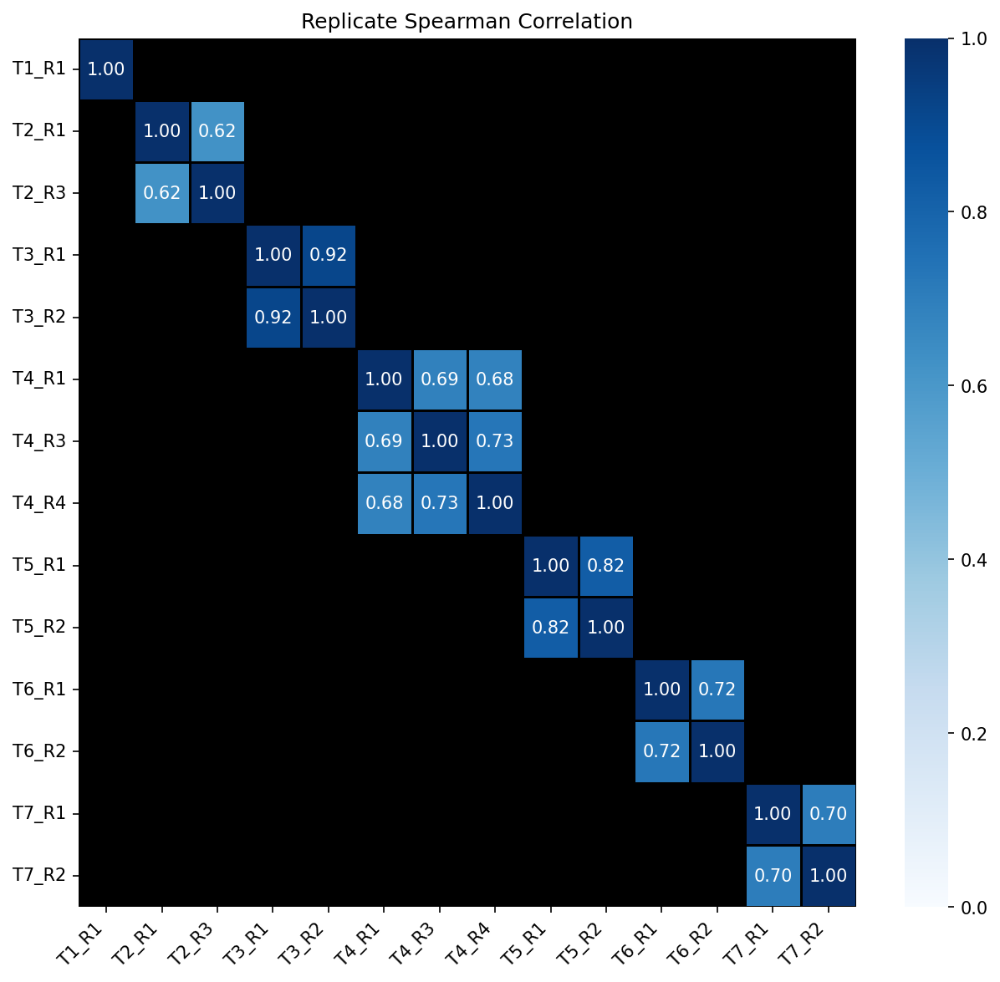
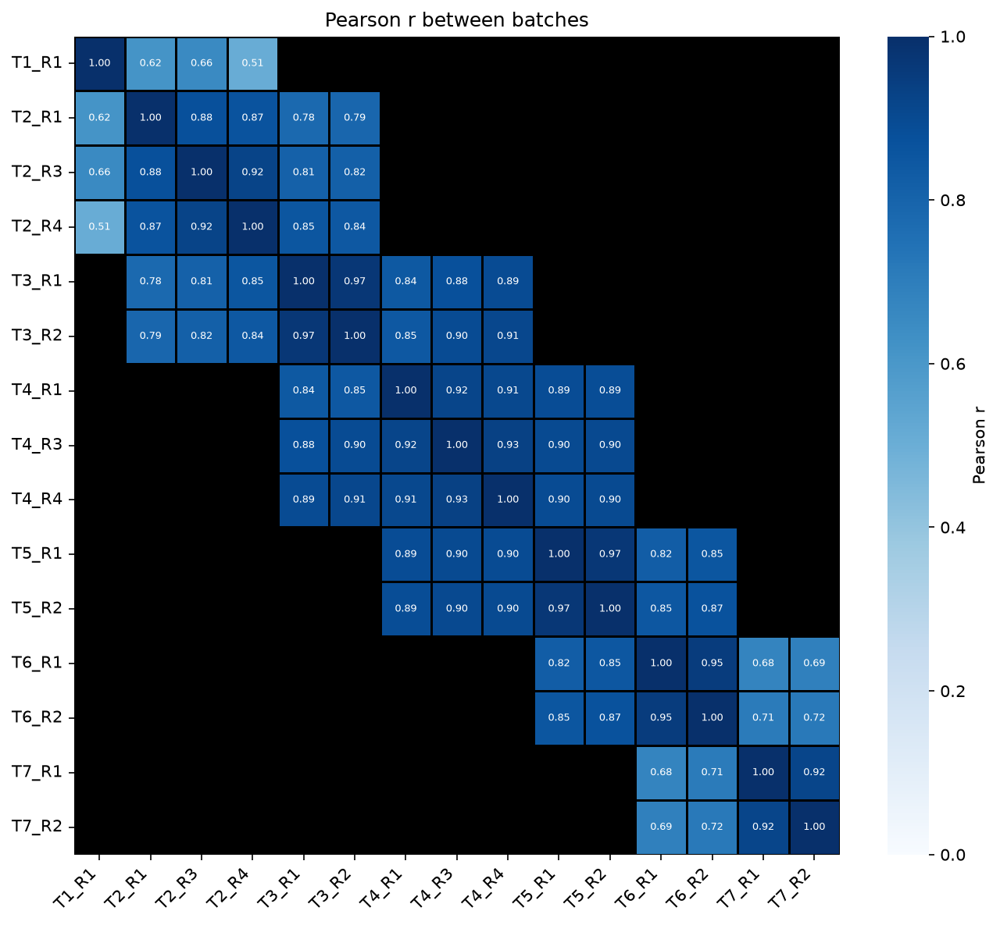
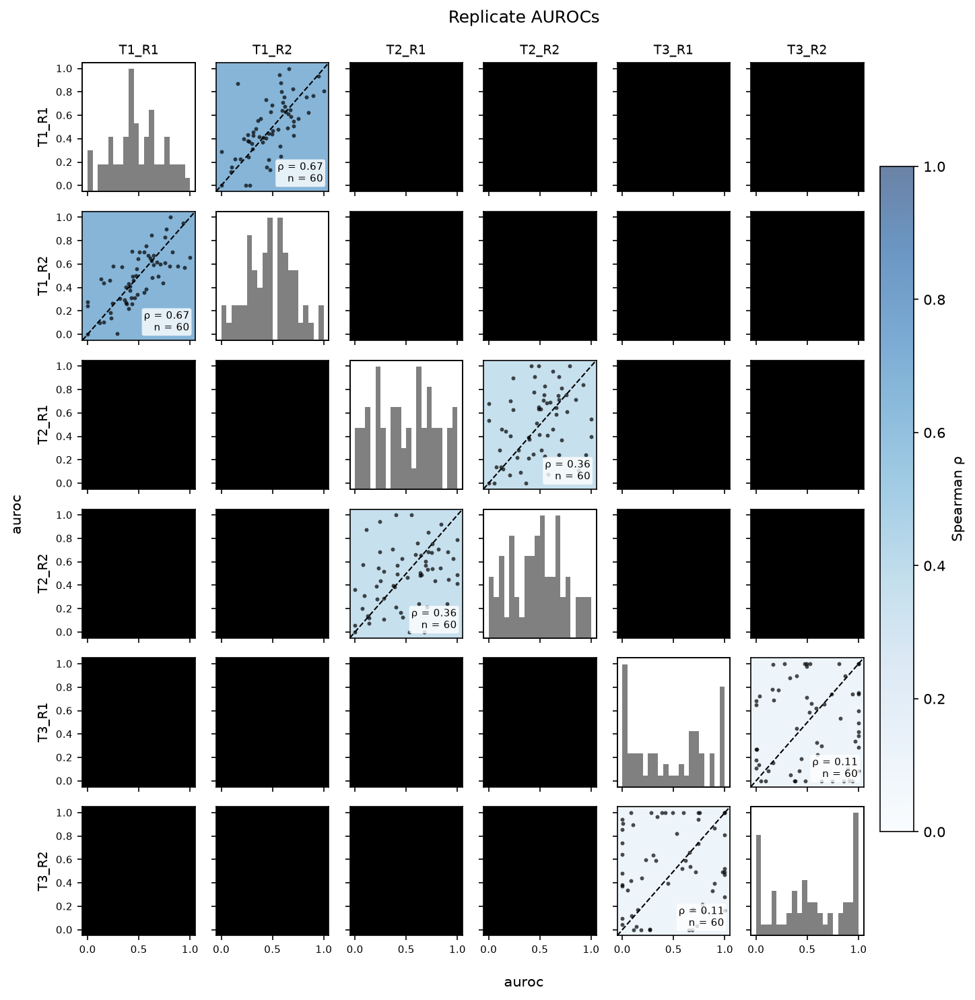
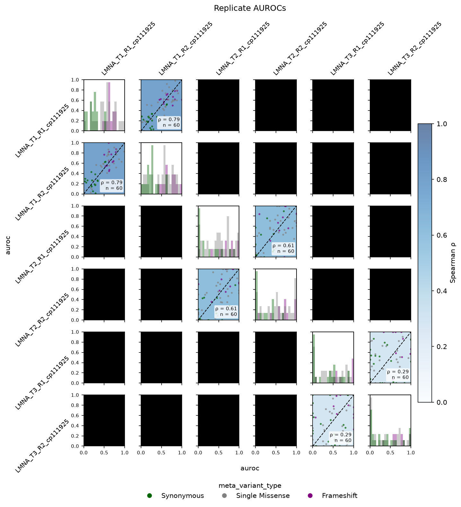
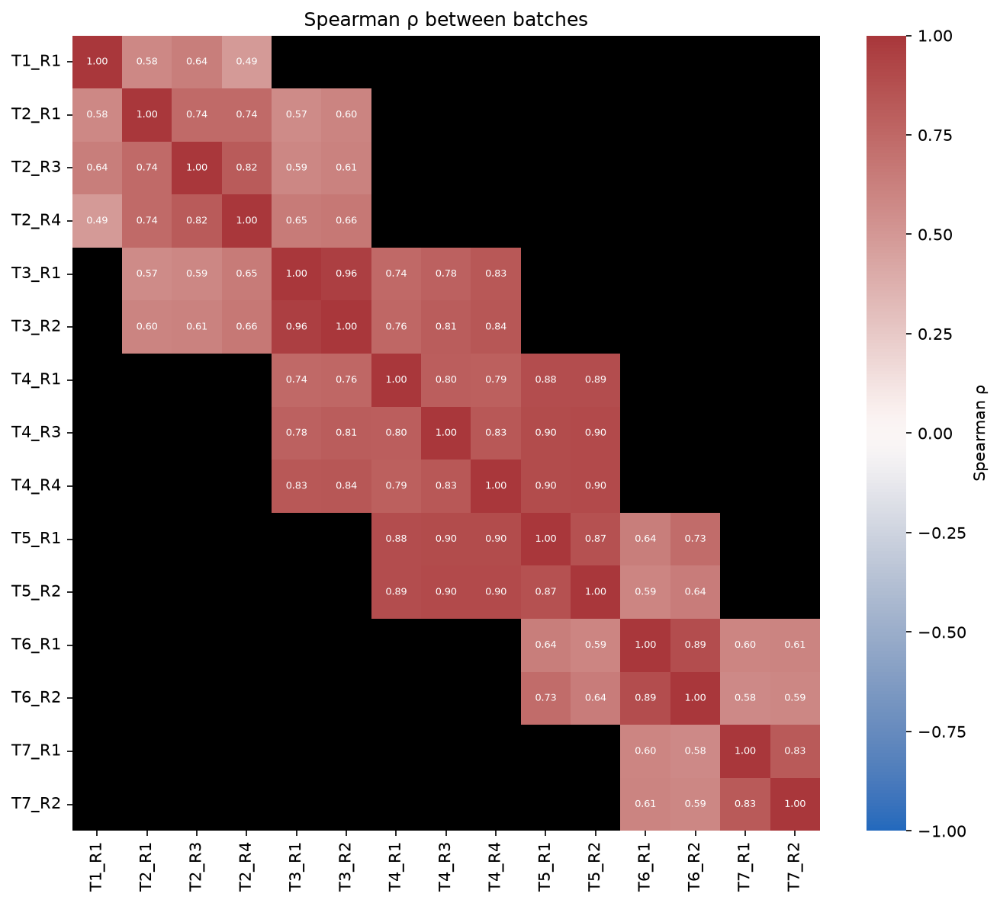
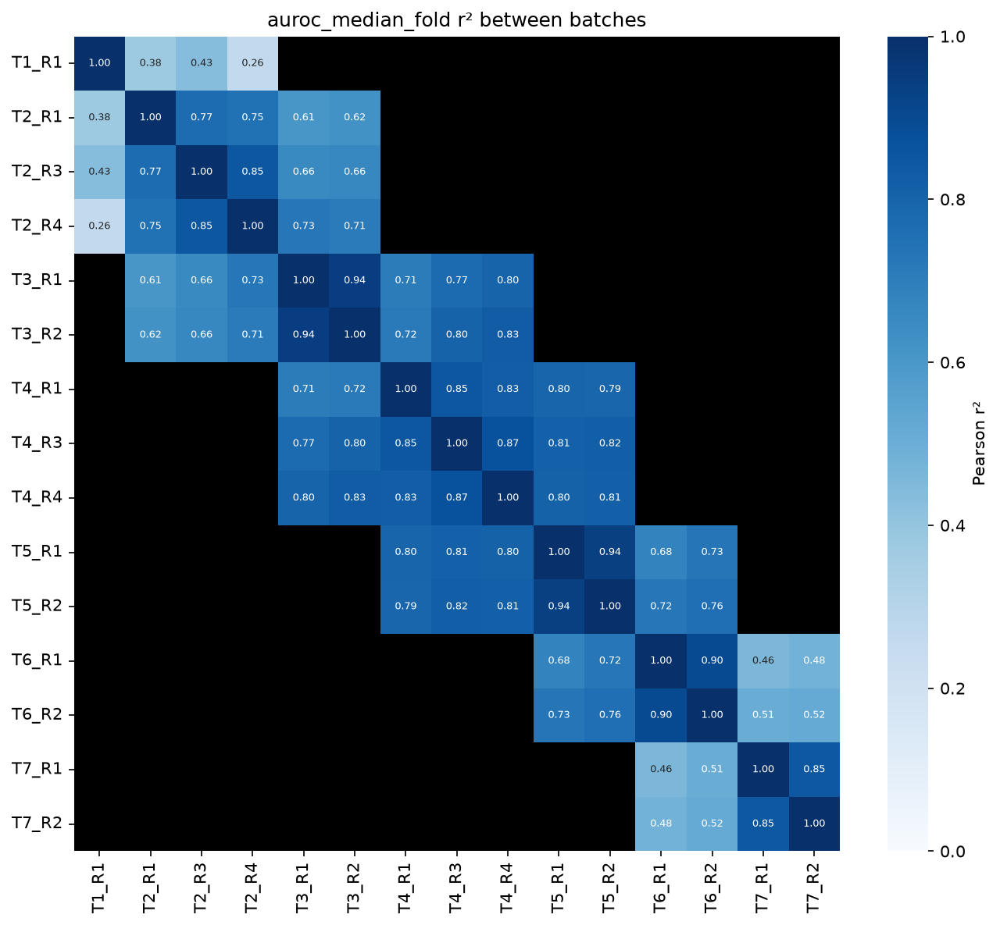

# Heatmaps

`Heatmap` draws a matrix given in either of two forms:

- **Long form:** one row per cell, with `index`, `columns` and `values` columns. It is pivoted for you.
- **Wide form:** an `index` column plus the matrix columns (`columns=[…]`, or every numeric column).

Rows and columns are sorted naturally unless you pass `row_order` / `col_order`. Any extra keyword
arguments, such as `linewidths` or `linecolor`, go straight to `seaborn.heatmap`.

## Pairwise matrix stored once per pair

Pairwise results are usually stored once per pair. `symmetric=True` fills each missing `(j, i)` cell
from `(i, j)`. `nan_color` sets the color shown for pairs that were never compared:

```python
import fisseqborn as fb

# one row per replicate pair within a tile (each replicate with itself too):
# rep_a, rep_b, spearman_r
(fb.Heatmap(rep_corr, index="rep_a", columns="rep_b", values="spearman_r",
            symmetric=True, nan_color="black",
            cmap="Blues", vmin=0, vmax=1, annot=True, fmt=".2f",
            linewidths=0.5, linecolor="black",
            figsize=(10, 9), title="Replicate Spearman Correlation")
   .save("vis/replicate_spearman_correlation_heatmap.png"))
```

{ width="520" }

*From `notebooks/2026-07-29/ovwt_rep_correlation`.*

## Batch correlation matrices

`BatchCorrelationHeatmap` computes that replicate matrix from the raw scores. You pass long-form
data with a `batch` column, a `label` column and a `score` column. Each cell is a
[metric](../concepts.md#metrics) (the Spearman correlation by default) of `score` between two batches, using one point per label the two batches
share. Pairs of batches that share no labels, or fewer than `min_shared` (default 10), are drawn
black:

```python
# one row per (experiment, variant): experiment, variant, test_auroc
(fb.BatchCorrelationHeatmap(ovwt, batch="experiment", label="variant", score="test_auroc",
                            title="Replicate Spearman Correlation")
   .save("vis/replicate_spearman_correlation_heatmap.png"))
```

{ width="520" }

*`metric="pearson"` on the 2026-09-29 OvWT scores (`batch="meta_experiment",
label="meta_aa_changes", score="auroc_median_fold"`). Batches on different tiles share no
variants, so only the block diagonal is filled.*

`metric=` takes any [metric](../concepts.md#metrics): `"spearman"`, `"pearson"`, `"cosine"`, their
squares (`"spearman_squared"` for ρ², ...) or a distance such as `"euclidean"`. Similarities use a
`Blues` scale from 0 to 1; distances use `Blues_r` from 0 to the largest value, so similar batches
are dark either way. `.pairs()` returns the numbers behind the plot:
`batch_a, batch_b, value, n_shared`, and `.metric_matrix` the `MetricMatrix`. Duplicate
`(batch, label)` rows are an error unless you pass `aggregate="mean"` (or similar).

### Two different scores

`y_score=` puts a second score on the rows (the y axis), while `score` stays on the columns (the x axis).
Cell `(a, b)` is the correlation of batch a's `y_score` with batch b's `score` over the labels the
two batches share. The two scores must be columns of the same frame, so join them on
`(batch, label)` first if they come from different tables:

```python
# one row per (experiment, variant): auroc_median_fold, missense_score
(fb.BatchCorrelationHeatmap(scores, batch="meta_experiment", label="meta_aa_changes",
                            score="auroc_median_fold", y_score="missense_score")
   .save("vis/ovwt_vs_missense_correlation_heatmap.png"))
```

The matrix is no longer symmetric. Its diagonal isn't 1: it holds each batch's own correlation
between the two scores. The axes are labeled with the two column names by default. Use
`.set(xlabel=..., ylabel=...)` to rename them. `.pairs()` then has one row per *ordered* pair, with
`batch_a` the row batch and `batch_b` the column batch.

### Scatter grid

`BatchCorrelationGrid` takes the same arguments and draws the same layout, but each cell is the
scatter plot behind its correlation: panel `(a, b)` has batch b's `score` on x and batch a's
`score` (or `y_score`) on y, one point per shared label. Without `y_score` the diagonal shows a
histogram of each batch's scores. Columns share x limits and rows share y limits, so each batch has
one scale throughout. Every panel has x tick labels; y tick labels are on the left column.

```python
(fb.BatchCorrelationGrid(ovwt, batch="experiment", label="variant", score="test_auroc",
                         identity=True, title="Replicate AUROCs")
   .save("vis/replicate_auroc_scatter_grid.png"))
```

{ width="620" }

*Synthetic data: three tiles with two replicates each, noisier on later tiles.*

By default each panel's background is tinted by its value on the heatmap's scale,
with a shared colorbar (`cmap=`, `vmin=`, `vmax=`, and `tint_alpha=` to keep points visible on dark
panels), and the value and shared-label count are written in the corner. Turn either off with
`tint=False` / `annot=False`. Pairs with fewer than `min_shared` shared labels are drawn in
`nan_color` with no points. `identity=True` adds the dashed `y = x` line to the scatter panels, and
`lims=(0, 1)` fixes both axes of every panel (and the histograms' range), for example for AUROCs.
`label_rotation=` slants the batch names for long experiment names: `45` slants both the column
and row names, and `90` makes the column names vertical and the row names horizontal. `height=` sets
each panel's size in inches (1.6 by default); the figure size follows from it. `scatter_kws` / `hist_kws` go to `ax.scatter` / `ax.hist`. It is figure-level:
`plot()` returns `(fig, axes)`, with `axes` a 2-D array. `.pairs()` returns the same numbers as the
heatmap's.

`hue=` colors the points by a column that describes the label, such as the variant type, and splits
each diagonal histogram into one overlaid histogram per level. Known levels get the fisseq order
and palette; `hue_order=` / `palette=` override them, and the legend goes below the grid. The first
level in `hue_order` is drawn on top, so put the one you most need to see (e.g. synonymous
controls) first. The hue
must have one value per label across batches, because each point is a label shared by two batches.
The correlations still use every shared label, whatever its hue.

`marginals="hist"` or `marginals="kde"` adds the distribution of each scatter panel's shared points
in strips along its top (x scores) and right (y scores) edges, split by `hue` when it is given.
Histograms use the same bins as the batch's diagonal histogram, and `hist_kws` applies to them.
Each KDE level is scaled by its share of the points. `marginal_size=` sets the strip depth as a
fraction of the panel (0.25 by default); the figure grows to fit the strips.

```python
fb.BatchCorrelationGrid(ovwt, batch="experiment", label="variant", score="test_auroc",
                        hue="meta_variant_type", identity=True, lims=(0, 1),
                        label_rotation=45)
```

{ width="620" }

`fill_value=` fills whatever is still missing, for example `fill_value=0.5` for barcode-pair AUROC
matrices. Duplicate `(index, columns)` pairs are an error unless you pass `aggregate="mean"` (or
`"median"`, `"first"`, …).

## Batch PERMANOVA and ANOVA

`BatchPermanovaHeatmap` and `BatchAnovaHeatmap` use the batch × batch layout too. Each cell tests
whether two batches *differ* on the variants they share, where the correlation heatmaps above show
how well they agree. Each variant is measured once in each batch, so the design is paired: the
experiment is the factor and the variant is a block. For batches A and B sharing n variants
(2n observations),

    F = SS_experiment / (SS_residual / (n − 1)),   SS_residual = SS_total − SS_variant − SS_experiment

A large F means the batches differ by more than their replicate noise. The diagonal and pairs with
fewer than `min_shared` shared variants (default 10) are drawn black.

- **PERMANOVA** (`BatchPermanovaHeatmap`) compares whole profiles. It takes the sums of squares
  from the distances between the 2n profiles under any [metric](../concepts.md#metrics)
  (`metric="euclidean"` by default). The p-value comes from `permutations` random swaps of A and
  B within variants (default 999, so the smallest p is 0.001). For cosine, Pearson and Spearman it
  uses `√(1 − s)`, which is a Euclidean distance; plain `1 − s` isn't, and can make the sums of
  squares negative. `sqrt=False` turns that off.
- **ANOVA** (`BatchAnovaHeatmap`) compares one score, on the same long-form data as
  `BatchCorrelationHeatmap`. F is the paired t², and the p-value comes from the F distribution on
  1 and n − 1 degrees of freedom. PERMANOVA with Euclidean distances on that one column gives
  the same F.

`value=` picks what the cells show: `"f"` (the default, `Blues_r` from 0, so batches that
agree are dark), `"p"` (`Blues`, 0 to 1) or `"-log10p"`.

```python
# one row per (experiment, variant), profile features as columns
plot = fb.BatchPermanovaHeatmap(profiles.drop_nonfinite(), metric="cosine",
                                permutations=999, n_jobs=8)
plot.save("vis/permanova_f.png")

# one row per (experiment, variant): auroc_median_fold
fb.BatchAnovaHeatmap(ovwt, batch="meta_experiment", label="meta_aa_changes",
                     score="auroc_median_fold", value="-log10p")
```

A `Profiles` supplies its own batch, variant and feature columns. For a plain DataFrame these
default to `meta_experiment`, `meta_aa_changes` and every numeric non-`meta_` column. A row with a
non-finite feature is left out, so drop such features first (`.drop_nonfinite()`, or read with
`features="intersection"`).

### Reusing the result

Each pair needs a 2n × 2n distance matrix and `permutations` evaluations of the statistic, so
PERMANOVA over many batches takes a while. Both tests give a `BatchTestMatrix` with the F, p and
shared-variant matrices. Save it, then pass it to either heatmap in place of the data, and nothing
is recomputed:

```python
res = fb.BatchTestMatrix.permanova(profiles, metric="cosine", n_jobs=8)
res.save("vis/permanova.parquet")       # or plot.result.save(...)

res = fb.BatchTestMatrix.load("vis/permanova.parquet")
fb.BatchPermanovaHeatmap(res, value="f").save("vis/permanova_f.png")
fb.BatchPermanovaHeatmap(res, value="p").save("vis/permanova_p.png")
```

`res.pairs()` (and the plots' `.pairs()`) is the long form: `batch_a, batch_b, f, p, n_shared`.
`res.matrix("f")` returns the matrix as a `MetricMatrix` for `Heatmap.from_matrix`, and
`res.params` records how the result was computed. Each pair draws its permutations from its own
stream of `seed`, so the p-values don't depend on `n_jobs`.

## Correlation matrices

`Heatmap.correlation` computes the matrix for you, with any [metric](../concepts.md#metrics)
between columns (Pearson by default). The scale follows the metric: a diverging `vlag` scale from
-1 to 1 for a correlation or cosine similarity, `Blues` from 0 to 1 for a squared one, `Blues_r`
from 0 for a distance. Cells are annotated:

```python
pcs = [f"meta_pc_{i}" for i in range(1, 6)]
fb.Heatmap.correlation(df, pcs, metric="cosine").save("vis/pc_similarity.png")
```

Each cell is computed over the rows where both of its columns are finite, so sparse inputs work.
For example, you can pass one column per batch where each batch covers a single tile. Spearman
ranks within each pair's shared rows. Cells with fewer than `min_shared` shared rows (default 10)
are NaN, so pass `nan_color="black"` to show them. The shared-row counts are on the plot's
`n_shared` attribute. `y_columns=` puts different columns on the rows than on the x axis
(`fb.Heatmap.correlation(df, cols, y_columns=other)`), which gives a `len(other) × len(cols)` matrix.
Pass `metric="pearson_squared"` (or `"spearman_squared"`) to show r² (or ρ²) instead:

```python
by_batch = scores.df.pivot(on="meta_experiment", index="meta_aa_changes",
                           values="auroc_median_fold")
plot = fb.Heatmap.correlation(by_batch, [c for c in by_batch.columns if c != "meta_aa_changes"],
                              nan_color="black")
plot.n_shared  # pandas DataFrame of shared variants per batch pair
```

<div class="grid" markdown>





</div>

*From `notebooks/2026-09-29/ovwtcv`, with `nan_color="black", min_shared=10,
annot_kws={"fontsize": 6}`: `metric="spearman"` (left) and `metric="pearson_squared"` (right).*

!!! tip
    Cosine similarity doesn't center the data. On AUROC-like scores, which all sit near 0.5, every
    pair comes out at about 0.99. Use Pearson or Spearman for those.

Use `Heatmap(...).matrix()` to get the drawn matrix as a pandas DataFrame.

## Any metric matrix

`Heatmap.from_matrix` draws a `MetricMatrix`, whether fisseqborn computed it or you load one:
the distances between variant profiles, a matrix from another tool, or one saved earlier. Rows and
columns keep the matrix's order, and the scale and colorbar label come from its metric:

```python
d = profiles.drop_nonfinite().distances("pearson")
fb.Heatmap.from_matrix(d).save("vis/variant_pearson.png")

theirs = fb.MetricMatrix.from_array(values, labels, kind="distance", label="Edit distance")
fb.Heatmap.from_matrix(theirs)
```
