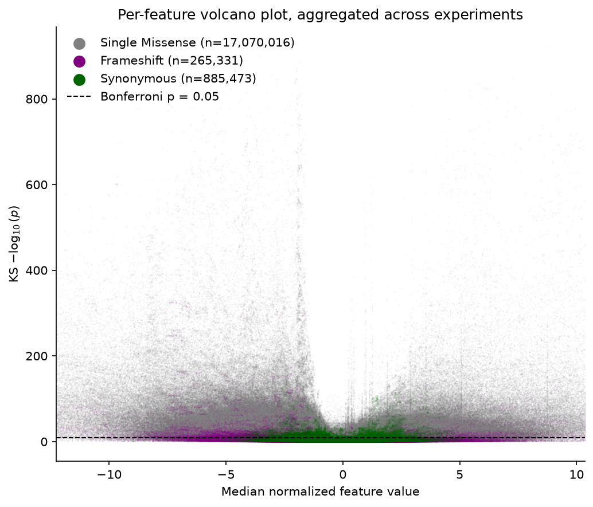
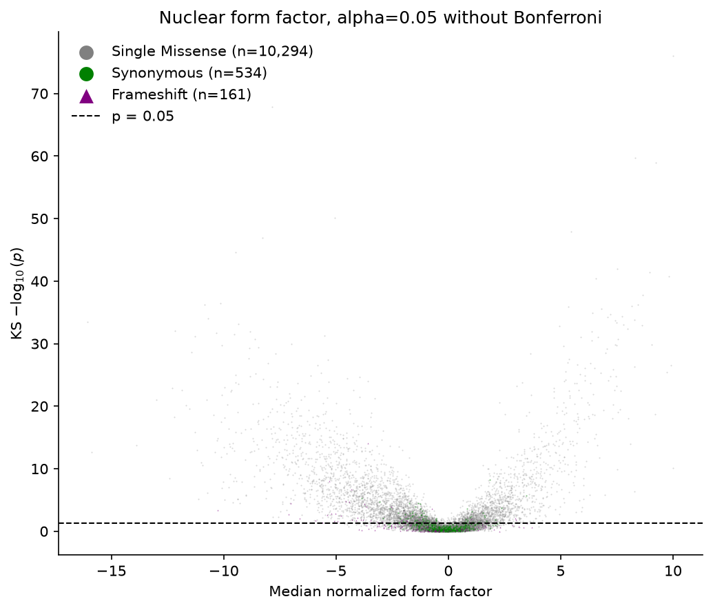

# Volcano plots

`VolcanoPlot` plots per-feature effect sizes against −log10(p), one point per
(variant, feature) pair. Points are added in groups with chained `.layer(where, label=…)` calls,
each selecting rows with a polars expression. Layers are drawn in the order they are added, so add
the largest group first and the controls last to keep them visible. Each legend entry counts its
points.

## All features, layered by variant type

`VolcanoPlot.from_wide` takes one row per variant with `<feature>_median` / `<feature>_KSnegLogP`
column pairs, as written by the pipeline, and unpivots them. Here `agg_df` is the per-variant
median across experiments, where each feature's p-value comes from the same experiment as its
median:

```python
import polars as pl
import fisseqborn as fb

volcano = fb.VolcanoPlot.from_wide(
    agg_df, title="Per-feature volcano plot, aggregated across experiments"
)
# back to front: missense cloud, then frameshifts, then synonymous controls on top
for variant_type in ["Single Missense", "Frameshift", "Synonymous"]:
    volcano = volcano.layer(pl.col("meta_variant_type") == variant_type, label=variant_type)

(volcano
   .set(xlabel="Median normalized feature value", ylabel=r"KS $-\log_{10}(p)$")
   .save("vis/volcano.png"))
```

{ width="560" }

*From `notebooks/2026-09-28/volcano-plots`: ~18 million points. The synonymous controls stay
near zero effect, while missense and frameshift variants spread out in both directions.*

By default:

- the dashed line marks Bonferroni-corrected p = 0.05 over every plotted point;
- the x axis is limited to the 0.1–99.9% quantiles (`x_quantiles=(0.001, 0.999)`), so a few
  extreme values don't squash the rest;
- rows with a missing or non-finite value are neither drawn nor counted;
- point size and transparency scale with the number of points: large, nearly opaque dots for a
  few hundred variants, shrinking to `s=1, alpha=0.1` by about a million points. Pass `s=` or
  `alpha=` to a `.layer()` to override them.

## Effect-size cutoff and labelled features

`effect_cutoff=` draws dotted vertical lines at ±cutoff; it has no default. `label_top=n`
annotates the top `n` significant points (above the significance line and beyond the cutoff, if
any) with their `label_by` value (`"feature"` by default). `label_rank="y"` (the default) picks
the most significant points, `label_rank="x"` the largest |effect|. The x axis widens so the
labelled points stay in view, and [adjustText](https://adjusttext.readthedocs.io) spreads the
labels apart inside the axes, with leader lines to their points. With labels, the legend moves
outside the axes to the right, out of the top corners where the labelled points usually are.

```python
(fb.VolcanoPlot.from_labels(labelled, "is_frameshift", effect="cohens_d",
                            effect_cutoff=0.2, label_top=10, label_rank="x")
   .save("vis/volcano_frameshift.png"))
```

## One feature, uncorrected threshold

To look at one feature, select its column pair before `from_wide`. `bonferroni=False` draws the
plain `alpha` line, `x_quantiles=None` shows every point, and each `.layer()` can override the
scatter style (`color`, `marker`, `alpha`, …):

```python
feat = "Mean_Nuclei_AreaShape_FormFactor"
one = agg_df.select(pl.col("^meta_.*$"), f"{feat}_median", f"{feat}_KSnegLogP")

(fb.VolcanoPlot.from_wide(one, bonferroni=False, x_quantiles=None,
                          title="Nuclear form factor, alpha=0.05 without Bonferroni")
   .layer(pl.col("meta_variant_type") == "Single Missense", label="Single Missense", alpha=0.3)
   .layer(pl.col("meta_variant_type") == "Synonymous", label="Synonymous",
          color="green", alpha=0.5)
   .layer(pl.col("meta_variant_type") == "Frameshift", label="Frameshift",
          marker="^", alpha=0.6)
   .set(xlabel="Median normalized form factor", ylabel=r"KS $-\log_{10}(p)$")
   .save("vis/volcano_form_factor.png"))
```

{ width="560" }

!!! warning
    `alpha=` on the **constructor** is the significance level, not transparency. Set point
    transparency per `.layer()`.

## Long-form data

The constructor takes long-form rows directly, for example after your own unpivot:

```python
fb.VolcanoPlot(long_df, x="median", y="KSnegLogP", alpha=0.01)
```

## From labels and features

`VolcanoPlot.from_labels` runs the tests itself. It takes one row per variant (or per cell), one or
more binary label columns (boolean or 0/1) and feature columns, and compares each label's true
rows with its false rows, one point per (label, feature) pair. The p-value test and the effect
size are chosen separately:

| `test=` | y column | | `effect=` | x column |
|---|---|---|---|---|
| `"ks"` (default) | `KSnegLogP` | | `"median"` (default) | `median_diff` |
| `"welch"` | `WelchNegLogP` | | `"mean"` | `mean_diff` |
| `"mannwhitney"` | `MWUnegLogP` | | `"cohens_d"` | `cohens_d` |

Effects are the positive group minus the negative group. Rows with a null label are left out of
that label's comparison, and missing or non-finite feature values are ignored. `features`
defaults to every numeric column that is neither `meta_*` nor a label.

```python
labelled = profiles.with_columns(
    is_frameshift=pl.col("meta_variant_type") == "Frameshift",
    is_pathogenic=pl.col("meta_clinvar_annotation") == fb.fisseq.PATHOGENIC,
)
(fb.VolcanoPlot.from_labels(labelled, ["is_frameshift", "is_pathogenic"],
                            test="ks", effect="median")
   .layer(pl.col("label") == "is_frameshift", label="Frameshift vs. rest")
   .layer(pl.col("label") == "is_pathogenic", label="Pathogenic vs. rest")
   .save("vis/volcano_labels.png"))
```

The computed table is `plot.data`: `label`, `feature`, `n_positive`, `n_negative` and the x and y
columns. A p-value that underflows to 0 is drawn at −log10 of the smallest float (~307.7).

!!! note
    The tests run in memory with scipy, so they suit per-variant tables. Cell-level tables can
    be large; the pipeline's aggregate stage computes `KSnegLogP` for cells on the cluster.
